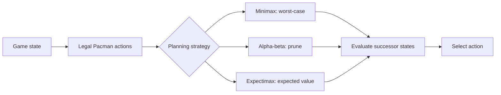

# -Pacman-AI-Multi-Agent-Adversarial-Search
**Portfolio case study | Artificial Intelligence · Game Theory · Search Algorithms**  A technical overview of a Pacman multi-agent AI project completed for **UIC MENG 419 / CS 411 Artificial Intelligence** using the educational Pacman framework from **UC Berkeley**.

> **Portfolio-only repository.** The course starter-code terms prohibit
> distributing or publishing completed solutions. Accordingly, this
> repository intentionally contains **no Pacman starter code, test fixtures,
> or completed `multiAgents.py`**. See [ATTRIBUTION.md](ATTRIBUTION.md).

## What I built

Five agent/evaluation components in a classic Pacman environment:

| Component | Decision strategy | Main idea |
|---|---|---|
| Reflex agent | Immediate heuristic | Choose a legal move using nearby rewards and threats |
| Minimax | Adversarial search | Optimize against worst-case ghost responses |
| Alpha-beta pruning | Optimized adversarial search | Avoid exploring branches that cannot improve a decision |
| Expectimax | Stochastic search | Choose actions based on expected outcomes of random ghost moves |
| Evaluation function | Heuristic design | Balance score, food, capsules, distance, and ghost danger |

## Decision-making architecture

## Why the strategies differ

- **Minimax** is useful when the opponent is assumed to choose the most
  damaging legal move.
- **Alpha-beta pruning** preserves minimax's decision while avoiding
  unnecessary exploration.
- **Expectimax** is useful when opponent actions are modeled probabilistically.
- **Heuristic evaluation** matters when exhaustive search is impractical.

## Local validation

The course-supplied local autograder reported **25/25 points across Q1–Q5**.
In the supplied game tests, the reflex agent and improved-evaluation agent
each won **10/10 games** (under their respective test configurations).
This is a **local test result**, not a claim about an official Gradescope score.
See [docs/TESTING_AND_LIMITATIONS.md](docs/TESTING_AND_LIMITATIONS.md).

## Connection to cybersecurity and cloud security

This project strengthened my understanding of adversarial decision-making:

- **Attacker–defender reasoning:** model opposing objectives rather than
  optimizing a single agent in isolation.
- **Worst-case planning:** evaluate security actions under unfavorable
  opponent behavior.
- **Uncertainty:** distinguish an actively adversarial opponent from
  a stochastic environment.
- **Efficiency:** apply pruning and heuristics when computation is limited.

These are conceptual parallels relevant to AI-assisted SOC triage and cloud
security operations; this project is **not** an intrusion detection tool.

## Project documentation

- [Algorithms and trade-offs](docs/ALGORITHMS.md)
- [Testing and limitations](docs/TESTING_AND_LIMITATIONS.md)
- [Learning reflections](docs/LEARNING_REFLECTIONS.md)
- [Attribution and publication policy](ATTRIBUTION.md)

## Attribution

Original Pacman framework and autograder: **UC Berkeley Pacman AI projects**,
[ai.berkeley.edu](http://ai.berkeley.edu). Project work completed in the
context of **UIC MENG 419 / CS 411 Artificial Intelligence**.

*The implementation is maintained in a private educational repository in
accordance with the course code's publication restrictions.*
